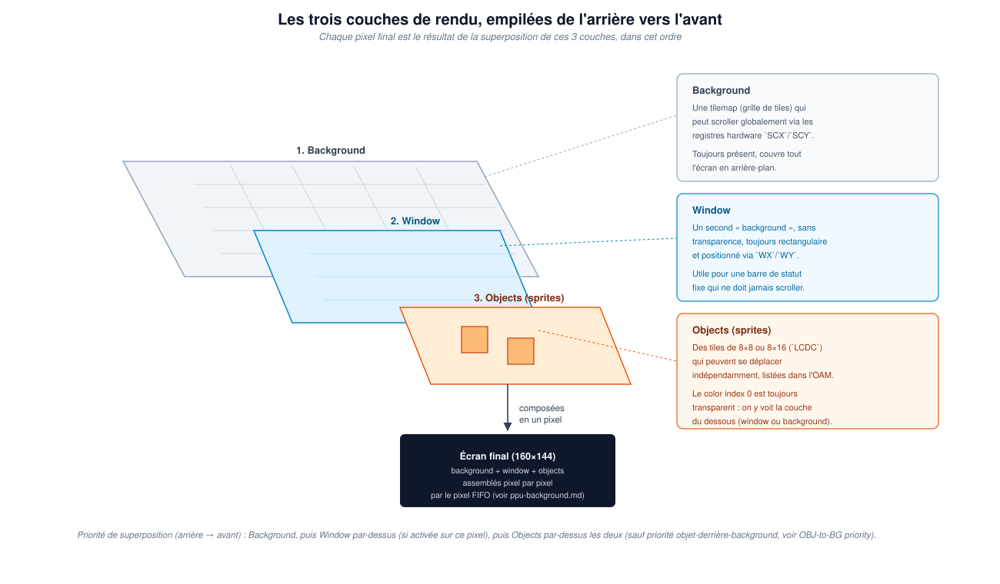

# 33. Les trois couches de rendu : background, window et objects

Le chapitre 32 a établi *quand* le PPU produit chaque pixel. Avant de
construire le mécanisme qui le fait réellement (le pixel FIFO et le
fetcher, couverts en détail dans le guide associé), il faut comprendre
*ce qui* compose ce pixel. La réponse : jusqu'à trois couches distinctes,
superposées.

## Trois couches, de l'arrière vers l'avant

La Game Boy a trois couches, empilées dans cet ordre précis — chacune
peut cacher celle qui se trouve derrière elle :

- **Background** : une tilemap (grille de tiles) qui peut scroller
  globalement via des registres hardware (`SCX`/`SCY`). Elle est
  toujours présente et couvre tout l'écran en arrière-plan.
- **Window** : un second « background » par-dessus, sans transparence,
  toujours rectangulaire, positionné via `WX`/`WY`. Utile pour une barre
  de statut fixe qui ne doit jamais scroller avec le reste de la scène.
- **Objects (sprites)** : des tiles de 8×8 ou 8×16 (contrôlé par
  `LCDC`) qui peuvent se déplacer indépendamment du quadrillage de la
  tilemap, listés dans l'OAM. Le color index 0 y est toujours
  transparent : à cet endroit précis, on voit la couche du dessous
  (window ou background) au travers.

## Pourquoi cet ordre compte

Chaque pixel final affiché à l'écran est le résultat de cette
superposition, évaluée dans l'ordre : le background est toujours là en
dessous de tout ; la window, quand elle est activée et que le pixel
courant tombe dans sa zone, le remplace entièrement (pas de mélange,
pas de transparence) ; les objects, enfin, se dessinent par-dessus les
deux — sauf pour leurs pixels de color index 0, qui restent transparents
et laissent voir ce qu'il y a dessous, et sauf le cas particulier de la
priorité objet-derrière-background (un bit par objet qui peut inverser
cette règle pour un sprite donné).

C'est précisément parce que ces trois couches ne sont *pas* indépendantes
— elles doivent être combinées pixel par pixel, au bon moment, dans le
bon ordre — que le vrai mécanisme du PPU ne peut pas se contenter de
dessiner trois images séparées puis les fusionner après coup. Il les
construit toutes les trois en même temps, dot par dot, pendant le mode 3
d'une seule scanline.

## D'où chaque couche tire réellement ses données

Les trois couches partagent certains mécanismes et en ont d'autres bien
à elles. Le registre `LCDC` (`$FF40`) est celui qui, bit par bit,
contrôle qui lit quoi et où.

### Background

- Passe par une tile map, `$9800` ou `$9C00` — le choix se fait via le
  **bit 3 de `LCDC`**.
- Chaque entrée de cette map est un *tile index* (un octet), résolu en
  adresse de tile data via le **bit 4 de `LCDC`** (mode signé/non-signé
  — voir la section 3.3 du [guide PPU](../ppu-background.md)).

### Window

- Oui, aussi via une tile map — mais la sélection est **indépendante**
  de celle du Background : le **bit 6 de `LCDC`** choisit laquelle des
  deux maps (`$9800`/`$9C00`) la Window utilise, séparément du bit 3 qui
  choisit celle du Background. Un jeu peut donc parfaitement avoir le
  Background sur une map et la Window sur l'autre, en même temps.
- Elle partage en revanche la **même tile data area** que le Background
  (le même bit 4 de `LCDC`) — ce n'est pas un jeu de tuiles différent,
  juste une disposition différente à l'écran : position fixe, pas de
  scroll, contrôlée par `WX`/`WY` au lieu de `SCX`/`SCY`.
- Donc Window = exactement le même mécanisme que Background (tile map →
  tile data → palette), juste une tile map séparée et un positionnement
  différent.

### Objects (sprites)

- Là, **pas de tile map du tout**. L'OAM (`$FE00`–`$FE9F`) contient
  directement, pour chacun des 40 sprites possibles, **4 octets** : la
  position Y, la position X, l'index de tuile, et un octet d'attributs
  (retournement horizontal/vertical, palette, priorité par rapport au
  background).
- Cet index de tuile pointe **directement** dans la tile data area
  (`$8000` et au-delà), **toujours en mode non-signé**, peu importe la
  valeur du bit 4 de `LCDC` — ce bit ne concerne que Background/Window.
  C'est une nuance qui piège beaucoup de monde : l'OAM ne contient pas
  de pixels, juste une référence + une position, exactement comme une
  entrée de tile map — sauf qu'il n'y a pas de grille 32×32
  intermédiaire : chaque sprite a sa position en pixels, libre.

## Ce qui vient ensuite

Ce chapitre, comme le précédent, pose les bases conceptuelles sans
modifier le code. Le guide
[PPU — Background Rendering Guide](../ppu-background.md) construit déjà
intégralement la couche background avec le véritable mécanisme de pixel
FIFO et de fetcher ; la window et les objects, une fois ce fondement en
place, s'ajoutent par-dessus sans réécriture — exactement comme annoncé
au chapitre 27.
